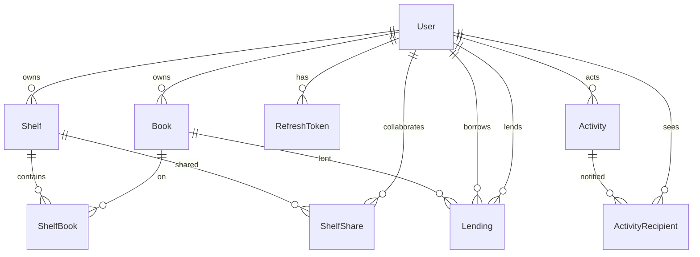

# BookNest

BookNest is a reading tracker. You keep your own library, log progress, organise books on shelves, share those shelves with editors or viewers, and lend a physical copy to another registered user. Live updates use Socket.io rooms so the other person sees a lend, a return, or a shelf change without refreshing.

The project is a NestJS API plus a Next.js App Router UI, with PostgreSQL in Docker. It is meant to be cloned, started, and exercised through the API or the browser.

> **Evaluator guide:** [Read the detailed technical overview](docs/TECHNICAL_OVERVIEW.md) for the complete stack, architecture, data model, security approach, feature flows, deployment, testing, and suggested evaluation path.

## Demo Video

- **Video Walkthrough:** [Demo Video Link Placeholder](https://www.loom.com/share/dcda01a2c4af4336983c4645860beb6b)


## Prerequisites

- Node.js 24+
- npm
- Docker Desktop
- Git

No API keys or hosted services are required.

## Ports

| Service  | Port | Notes |
|----------|------|--------|
| Frontend | 3000 | Next.js |
| Backend  | 4000 | NestJS, Swagger at `/api/docs` |
| Postgres | 5432 | Set `POSTGRES_PORT=5433` in the root `.env` if 5432 is already in use |

The app also works with any PostgreSQL instance if `DATABASE_URL` points at it.

## Test credentials (after seed)

```
alice@test.com / Password@123
bob@test.com   / Password@123
```

Password rule for new accounts: at least 8 characters, one uppercase letter, one lowercase letter, and one number.

## How to run

### A) Development (database in Docker, apps on your machine)

1. Copy env files (PowerShell):

```
Copy-Item .env.example .env
Copy-Item backend\.env.example backend\.env
Copy-Item frontend\.env.example frontend\.env
```

2. Put real JWT secrets in `backend\.env`:

```
node -e "console.log(require('crypto').randomBytes(64).toString('hex'))"
```

Run that twice. Paste one value into `JWT_ACCESS_SECRET` and a different value into `JWT_REFRESH_SECRET`. If port 5432 is taken, set `POSTGRES_PORT=5433` in the root `.env` and match that port in `backend\.env` `DATABASE_URL`.

3. Start Postgres:

```
docker compose up -d db
```

Wait until `docker compose ps` shows `healthy`.

4. Backend:

```
cd backend
npm install
npx prisma generate
npx prisma migrate deploy
npm run seed
npm run start:dev
```

You should see Nest mapped routes and `GET http://localhost:4000/health` returning `{ "status": "ok", "database": "up" }`.

5. Frontend (second terminal):

```
cd frontend
npm install
npm run dev
```

Open http://localhost:3000 and sign in as Alice.

### B) One-command mode (evaluator)

From a clone with Docker running:

```
Copy-Item .env.example .env
docker compose up --build
```

Compose starts Postgres, waits until it is healthy, runs `prisma migrate deploy`, runs the seed, then serves the API on 4000 and the UI on 3000. Inside Docker the database host is `db`, not `localhost`. JWT values in compose are local placeholders; generate your own for anything beyond this machine.

Stop with `Ctrl+C`, then `docker compose down` if you want the containers removed. Data lives in the `booknest_pgdata` volume.

## Data model



A user owns books and shelves. `ShelfBook` is the join table; deleting a shelf or a book removes the link, never the other side's rows except when a book itself is deleted (lending rows go with it). `ShelfShare` is a collaborator with role EDITOR or VIEWER. A lending is active while `returnedAt` is null; a partial unique index on `bookId` where `returnedAt IS NULL` makes two active lendings of the same book impossible even under concurrent requests.

## Stack choice

NestJS keeps HTTP, JWT, validation, and Socket.io in one TypeScript process with clear modules. Prisma matches the relational rules (cascades, partial unique index via SQL). PostgreSQL is the database the assessment asked for. Next.js App Router plus TanStack Query is a straightforward authenticated UI with loading and error states. Socket.io is used instead of polling because events are rare and must be scoped to one user or one shelf.

## Refresh-token flow

- Access token: 15 minutes, JWT, kept **in memory** on the frontend (not localStorage). Sent as `Authorization: Bearer`. XSS cannot read a cookie that is not there, and cannot read memory as easily as `localStorage`.
- Refresh token: 7 days, random bytes, **httpOnly** cookie, `SameSite=Lax` (Secure in production), path `/auth`. Only an HMAC hash is stored in `RefreshToken`.
- On `/auth/refresh` the old row is revoked and a new cookie is issued (rotation).
- If a **revoked** token is presented, every refresh row for that user is revoked (theft detection).
- On first page load the frontend calls `/auth/refresh` once. On a 401 from an expired access token it refreshes **once** (other calls wait) and retries. If refresh fails, the session is cleared and the user is sent to `/login`.

## Shelf roles (backend is the real check)

`ShelfAccessService.requireRole(shelfId, userId, minRole)` is the only access helper.

- No row and not the owner → **404** `Shelf not found` (does not leak that the shelf exists).
- Collaborator below the required role → **403**. Owner-only actions say `Only the shelf owner can do this`. Viewers adding/removing books say `Viewers cannot add or remove books on this shelf`.
- EDITOR may add **their own** books and remove **any** book from the shelf. VIEWER is read-only. OWNER can share, change a role, remove a collaborator, rename, and delete.

Hiding buttons in the UI is convenience. A viewer who POSTs `/shelves/:id/books` still gets 403.

## WebSockets

The client sends the access token in `handshake.auth.token`. The gateway verifies the JWT and disconnects if it is invalid. On connect the server joins `user:{userId}` and `shelf:{shelfId}` for every owned or shared shelf. Clients never choose rooms.

When a shelf is shared, that user's live sockets join the shelf room. When they are removed or the shelf is deleted, they leave immediately.

Events go only to those rooms: `lending:created`, `lending:returned`, `shelf:book-added`, `shelf:book-removed`, `shelf:shared`, `shelf:role-changed`, `shelf:access-removed`, `activity:new`.

If the socket drops, a banner says `Live updates disconnected, reconnecting...`. HTTP still works. On reconnect the current queries are refetched so missed events are recovered. Socket.io is used instead of polling so each user only receives their own events and the server does not wake idle clients every few seconds.

## Design decisions

- **Editor rule:** an editor can add books they own and can remove any book from the shared shelf. Removing a book only deletes the `ShelfBook` link.
- **404 vs 403:** if you cannot see the resource, you get 404. If you can see it but cannot change it, you get 403.
- **Deleting a lent book is allowed.** Lending rows cascade away; the borrower's live list updates.
- **Password rules:** 8+ characters, upper, lower, number.
- **Rename** is owner-only, same as delete.
- **Logout** is a public route so an expired access token can still clear the refresh cookie.
- **Progress** is a dedicated `PATCH /books/:id/progress` endpoint; `currentPage` is not a general book field you can PATCH.
- **Tests use Vitest + Supertest** (current Nest default) against `booknest_test`, not Jest.

## What was hard

The partial unique index is not expressible in Prisma schema, so it lives in SQL. Refresh rotation plus theft detection needs careful cookie path and hash storage. Shelf access has to distinguish 404 from 403 without leaking existence. Progress validation must stay 400 with field messages, never 500. Socket rooms must be server-assigned so a viewer cannot subscribe to another user's feed.

## Known issues

- Compose JWT secrets are development placeholders; generate your own random secrets for production deployments.
- No email invitations for unregistered users; shelf sharing and book lending require an existing registered user account.

## What I'd improve

- Add an automated E2E test for the Socket.io WebSocket handshake and live event reception in the CI test runner.
- Introduce email invitations for unregistered collaborators.
- Provide book cover art uploads or integration with an open book metadata API (e.g. Open Library).
- Add full end-to-end browser tests using Playwright.

## Requirement map (1–32)

| # | Requirement | Implementation / Location | Tested In |
|---|-------------|---------------------------|-----------|
| 1 | Register (name, email, password rules) | `POST /auth/register` in [`auth.controller.ts`](file:///d:/Projects/BookNest/backend/src/auth/auth.controller.ts), [`register.dto.ts`](file:///d:/Projects/BookNest/backend/src/auth/dto/register.dto.ts) | `critical-path.e2e-spec.ts` |
| 2 | bcrypt hash cost 12, never returned | [`auth.service.ts`](file:///d:/Projects/BookNest/backend/src/auth/auth.service.ts), `USER_SELECT` strips `passwordHash` | `critical-path.e2e-spec.ts` |
| 3 | 15m access token + 7d httpOnly refresh cookie | `issueSession` in [`auth.service.ts`](file:///d:/Projects/BookNest/backend/src/auth/auth.service.ts), cookie path `/auth` | `critical-path.e2e-spec.ts` |
| 4 | Refresh rotation, reuse revokes all sessions | `refresh` in [`auth.service.ts`](file:///d:/Projects/BookNest/backend/src/auth/auth.service.ts), `RefreshToken.revokedAt` | `critical-path.e2e-spec.ts` |
| 5 | Logout, global JWT guard, rate-limiting, 401 retry | [`jwt-auth.guard.ts`](file:///d:/Projects/BookNest/backend/src/common/guards/jwt-auth.guard.ts), `ThrottlerGuard`, [`api.ts`](file:///d:/Projects/BookNest/frontend/src/lib/api.ts) retry queue | `critical-path.e2e-spec.ts` |
| 6 | Book create with class-validator validation | `POST /books` in [`books.controller.ts`](file:///d:/Projects/BookNest/backend/src/books/books.controller.ts), [`create-book.dto.ts`](file:///d:/Projects/BookNest/backend/src/books/dto/create-book.dto.ts) | `critical-path.e2e-spec.ts` |
| 7 | Owner-scoped CRUD, other users' books return 404 | [`books.service.ts`](file:///d:/Projects/BookNest/backend/src/books/books.service.ts) (`requireOwnedBook`, `findOne`) | `critical-path.e2e-spec.ts` |
| 8 | Book update & delete with clean cascade | `PATCH /books/:id`, `DELETE /books/:id` in [`books.controller.ts`](file:///d:/Projects/BookNest/backend/src/books/books.controller.ts) | `critical-path.e2e-spec.ts` |
| 9 | Filter, search, sort (nulls last), pagination | `findMany` in [`books.service.ts`](file:///d:/Projects/BookNest/backend/src/books/books.service.ts), stable id tiebreaker | `books.controller.ts` |
| 10 | Shelves CRUD (create, rename, list, delete) | [`shelves.controller.ts`](file:///d:/Projects/BookNest/backend/src/shelves/shelves.controller.ts), [`shelves.service.ts`](file:///d:/Projects/BookNest/backend/src/shelves/shelves.service.ts) | `critical-path.e2e-spec.ts` |
| 11 | Many-to-many books on shelves (`ShelfBook`) | `POST /shelves/:id/books`, `DELETE /shelves/:id/books/:bookId` | `critical-path.e2e-spec.ts` |
| 12 | Shelf detail for owner and collaborators | `GET /shelves/:id` with collaborator role & member list | `critical-path.e2e-spec.ts` |
| 13 | Share shelf by email (EDITOR / VIEWER) | `POST /shelves/:id/shares` in [`shelves.service.ts`](file:///d:/Projects/BookNest/backend/src/shelves/shelves.service.ts) | `critical-path.e2e-spec.ts` |
| 14 | EDITOR adds own books / removes any; VIEWER 403 | [`shelf-access.service.ts`](file:///d:/Projects/BookNest/backend/src/shelves/shelf-access.service.ts) (`requireRole`) | `critical-path.e2e-spec.ts` |
| 15 | Only OWNER can share, change role, rename, delete | [`shelves.service.ts`](file:///d:/Projects/BookNest/backend/src/shelves/shelves.service.ts) requires `AccessRole.OWNER` | `critical-path.e2e-spec.ts` |
| 16 | Shared-with-me list & shelf activity records | `GET /shelves/shared-with-me`, activities `SHELF_SHARED`, `ROLE_CHANGED`, etc. | `critical-path.e2e-spec.ts` |
| 17 | Owner-only reading progress, status must be READING | `PATCH /books/:id/progress` in [`books.service.ts`](file:///d:/Projects/BookNest/backend/src/books/books.service.ts) | `critical-path.e2e-spec.ts` |
| 18 | Progress validation (page > total, negatives, non-ints) | `fieldBadRequest` in [`books.service.ts`](file:///d:/Projects/BookNest/backend/src/books/books.service.ts) returns 400 details | `critical-path.e2e-spec.ts` |
| 19 | Auto-finish on totalPages, finishedAt, STATUS_CHANGED | `logProgress` in [`books.service.ts`](file:///d:/Projects/BookNest/backend/src/books/books.service.ts), `progressPercentage` | `critical-path.e2e-spec.ts` |
| 20 | Lend by email (`POST /books/:id/lend`), reject self/unknown | [`lending.service.ts`](file:///d:/Projects/BookNest/backend/src/lending/lending.service.ts) (self 400, unknown email 404) | `critical-path.e2e-spec.ts` |
| 21 | Already lent 409 via transaction + partial unique index | `Lending_bookId_active_key` (`WHERE "returnedAt" IS NULL`) | `critical-path.e2e-spec.ts` |
| 22 | Borrowed-from-others list (`GET /books/borrowed`) | `listBorrowed` in [`lending.service.ts`](file:///d:/Projects/BookNest/backend/src/lending/lending.service.ts), read-only for borrower | `critical-path.e2e-spec.ts` |
| 23 | Owner marks returned (`POST /books/:id/return`) | `returnBook` in [`lending.service.ts`](file:///d:/Projects/BookNest/backend/src/lending/lending.service.ts), `lentTo` on book response | `critical-path.e2e-spec.ts` |
| 24 | Owner can delete lent book; cascades cleanly | `Book.lendings` cascade on delete; borrower notified via socket | `critical-path.e2e-spec.ts` |
| 25 | Activity feed (`GET /activity` latest 20) | [`activity.controller.ts`](file:///d:/Projects/BookNest/backend/src/activity/activity.controller.ts) via `ActivityRecipient` | `api.http`, seed verification |
| 26 | WebSockets auth at handshake with access token | `use` middleware in [`realtime.gateway.ts`](file:///d:/Projects/BookNest/backend/src/realtime/realtime.gateway.ts) verifies JWT | `live-updates.tsx` |
| 27 | Scoped rooms `user:{id}` and `shelf:{id}` | `handleConnection` in [`realtime.gateway.ts`](file:///d:/Projects/BookNest/backend/src/realtime/realtime.gateway.ts) | `realtime.service.ts` |
| 28 | Server-managed rooms (clients cannot pick rooms) | Rooms joined exclusively by server in [`realtime.service.ts`](file:///d:/Projects/BookNest/backend/src/realtime/realtime.service.ts) | `realtime.service.ts` |
| 29 | Realtime events emitted to user/shelf rooms | `lending:created/returned`, `shelf:book-added/removed`, `shelf:shared`, etc. | [`realtime.service.ts`](file:///d:/Projects/BookNest/backend/src/realtime/realtime.service.ts) |
| 30 | Frontend query invalidation on socket events | [`live-updates.tsx`](file:///d:/Projects/BookNest/frontend/src/components/live-updates.tsx) invalidates TanStack queries | `live-updates.tsx` |
| 31 | Reconnect banner, token refresh before reconnect | Reconnecting banner in [`live-updates.tsx`](file:///d:/Projects/BookNest/frontend/src/components/live-updates.tsx), fallback to HTTP | `live-updates.tsx` |
| 32 | Dashboard aggregates (counts, finished this year, rating, shelves) | `GET /dashboard` in [`dashboard.service.ts`](file:///d:/Projects/BookNest/backend/src/dashboard/dashboard.service.ts) | `dashboard.controller.ts` |

## Where I used AI and what I learned
<!-- Blank template for candidate to fill in honestly before the interview -->

### Which parts AI helped with
- 

### What I wrote / refactored by hand
- 

### What I can explain without looking
- 

### A tricky bug or obstacle I diagnosed and resolved myself
- 

### Key takeaways & lessons learned
- 

## More docs

- [docs/TECHNICAL_OVERVIEW.md](docs/TECHNICAL_OVERVIEW.md) — detailed stack, architecture, methodology, security, and evaluator guide
- [docs/WALKTHROUGH.md](docs/WALKTHROUGH.md) — eight files to explain on a call
- [docs/DEMO_SCRIPT.md](docs/DEMO_SCRIPT.md) — five-minute two-browser demo
- [api.http](api.http) — sample REST calls, including a forbidden viewer action
